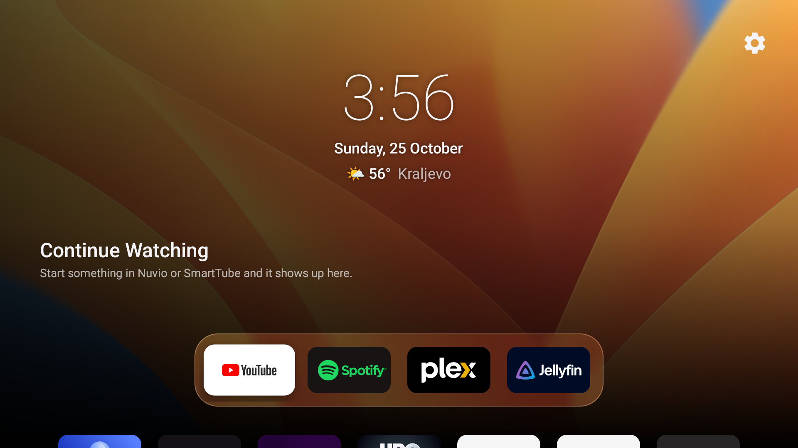

# Metak

An Apple TV-inspired home screen for Android TV and Google TV, with a favorite-app dock, an app grid, weather, and Continue Watching from supported apps.



*Actual capture from a ZTE MediaBox B866V2 running Android 12. Continue Watching is empty in this capture; its availability depends on playback entries published by other apps.*

[Download Metak](https://github.com/GeorgeHarbor/Metak/releases/latest) · [SmartTube Harbor](https://github.com/GeorgeHarbor/SmartTube)

Want a coding assistant to do the setup? Copy the [full setup prompt below](#copyable-setup-prompt) or use the [standalone document](docs/setup-prompt.md). It includes identifying and configuring a replacement Home button for remotes that lack one.

## Set up and debloat a TV or set-top box

This guide installs released APKs of Metak and SmartTube Harbor and explains how to disable unwanted apps with a recovery path. No source build is required. Metak requires **Android 8.0 / API 26 or newer**. These instructions target Android TV and Google TV; Samsung Tizen, LG webOS and Fire OS are outside this guide's scope.

Package names and launcher restrictions vary by manufacturer. There is no universal safe debloat list. Keep the original launcher available until Metak works on your device.

### 1. Identify the device and choose what to keep

Write down your TV or set-top box model. For a separate box, record the connected TV model too. Decide:

- Which streaming and music apps to keep.
- Whether to keep voice assistant, Chromecast/other casting and firmware updates.
- Which apps belong in the dock, in what order, and your weather city.
- Whether the remote has a Home button. If it does not, choose a physical button and press type (single press or long press) to open Metak, and confirm which original action you are willing to replace.
- Whether any USB devices are attached, including a USB Ethernet adapter.

Some firmware interrupts USB accessories when debugging is enabled. Check that Ethernet or Wi-Fi still works before making changes. Keep a remote available for authorization prompts and recovery.

### 2. Enable debugging and connect

Install Android's [SDK Platform Tools](https://developer.android.com/tools/releases/platform-tools) on a computer on the same network. On the TV, open Settings → About and select **Build** seven times. Enable USB debugging and Network/ADB debugging if offered. Menu names vary.

For devices exposing network ADB on port 5555:

```sh
adb connect TV_IP:5555
adb devices -l
```

Accept the **Allow USB debugging?** prompt on the TV. For Wireless debugging, use the pairing and connection addresses shown on the device; the ports can differ:

```sh
adb pair TV_IP:PAIRING_PORT
adb connect TV_IP:CONNECTION_PORT
adb devices -l
```

Use an explicit device serial for every command, especially when several devices are connected. In the examples below, replace the serial once and keep using the same terminal:

```sh
TV_SERIAL='192.168.1.120:5555' # Replace with your device's ADB serial.
TV_USER=$(adb -s "$TV_SERIAL" shell am get-current-user | tr -d '\r')
adb -s "$TV_SERIAL" shell getprop ro.product.manufacturer
adb -s "$TV_SERIAL" shell getprop ro.product.model
adb -s "$TV_SERIAL" shell getprop ro.build.version.release
adb -s "$TV_SERIAL" shell getprop ro.build.version.sdk
adb -s "$TV_SERIAL" shell getprop ro.product.cpu.abilist
adb -s "$TV_SERIAL" shell wm size
adb -s "$TV_SERIAL" shell wm density
```

Stop if the selected device is wrong or the current user could not be determined. If using a remote/Tailscale address, connect directly to it. If connection fails, distinguish authorization, network reachability and local execution restrictions before changing device settings. Not every device supports switching to port 5555.

### 3. Back up before changing anything

Create a dated folder on your computer:

```sh
BACKUP_DIR="tv-backup-$(date +%Y%m%d-%H%M%S)"
mkdir -p "$BACKUP_DIR"
adb -s "$TV_SERIAL" shell getprop > "$BACKUP_DIR/getprop.txt"
adb -s "$TV_SERIAL" shell pm list packages -f -U --show-versioncode > "$BACKUP_DIR/packages.txt"
adb -s "$TV_SERIAL" shell pm list packages -d --user "$TV_USER" > "$BACKUP_DIR/disabled.txt"
adb -s "$TV_SERIAL" shell dumpsys package > "$BACKUP_DIR/package-details.txt"
adb -s "$TV_SERIAL" shell settings list global > "$BACKUP_DIR/settings-global.txt"
adb -s "$TV_SERIAL" shell settings --user "$TV_USER" list secure > "$BACKUP_DIR/settings-secure.txt"
adb -s "$TV_SERIAL" shell settings --user "$TV_USER" list system > "$BACKUP_DIR/settings-system.txt"
adb -s "$TV_SERIAL" shell cmd package query-activities --user "$TV_USER" -a android.intent.action.MAIN -c android.intent.category.HOME > "$BACKUP_DIR/home-handlers.txt"
adb -s "$TV_SERIAL" shell cmd package resolve-activity --brief --user "$TV_USER" -a android.intent.action.MAIN -c android.intent.category.HOME > "$BACKUP_DIR/default-home.txt"
adb -s "$TV_SERIAL" shell wm size > "$BACKUP_DIR/display-size.txt"
adb -s "$TV_SERIAL" shell wm density > "$BACKUP_DIR/display-density.txt"
adb -s "$TV_SERIAL" shell screencap -p /sdcard/metak-before.png
adb -s "$TV_SERIAL" pull /sdcard/metak-before.png "$BACKUP_DIR/before.png"
```

Check the outputs for errors. These files record configuration; they are **not a full app-data backup**. Keep them private: properties, settings and screenshots may contain account and network details.

Start a change log and a restore script before disabling packages. Record each package's original per-user `enabled` value from `dumpsys package`, the original HOME component, and the old value of every setting you change. If a setting was originally absent, restoration should delete it rather than write the string `null`.

### 4. Measure the baseline

If you want a performance comparison, capture the original launcher at idle before installing or disabling anything:

```sh
adb -s "$TV_SERIAL" shell dumpsys meminfo > "$BACKUP_DIR/before-meminfo.txt"
adb -s "$TV_SERIAL" shell cat /proc/meminfo > "$BACKUP_DIR/before-proc-meminfo.txt"
adb -s "$TV_SERIAL" shell dumpsys cpuinfo > "$BACKUP_DIR/before-cpu.txt"
adb -s "$TV_SERIAL" shell ps -A > "$BACKUP_DIR/before-processes.txt"
adb -s "$TV_SERIAL" shell df -k /data > "$BACKUP_DIR/before-storage.txt"
```

For a fairer comparison, use the same settling time and sample interval before and after, record uptime and foreground app, and avoid playback or downloads while sampling. Prefer `MemAvailable` over `MemFree` alone; available RAM includes reclaimable memory. CPU snapshots can include earlier activity, so use repeated samples or deltas from `/proc/stat` for a defined measurement interval. Report background activity and reboot differences. Do not present a single snapshot as proof of a speed improvement.

### 5. Download official release APKs

Use the official release pages and inspect the latest release metadata at installation time:

| App | Official releases | APK selection |
| --- | --- | --- |
| Metak | [Latest release](https://github.com/GeorgeHarbor/Metak/releases/latest) | Released Metak APK compatible with the device's SDK |
| SmartTube Harbor | [Harbor releases](https://github.com/GeorgeHarbor/SmartTube/releases) | Match the device ABI, such as `armeabi-v7a` or `arm64-v8a`, or use an offered compatible universal APK |

Do not use APK mirrors, guessed asset URLs or source ZIP files. Record the release page, version, APK URL and SHA-256 checksum. Compare published digests when supplied. Inspect APK package name, version and minimum SDK before installation, using an Android SDK tool such as `aapt dump badging`.

**Harbor release naming:** the official Harbor README currently describes its rolling `latest` builds as **beta**, even though GitHub may mark the release as non-prerelease. If you require stable releases only, stop and explicitly choose whether to accept the official beta or leave Harbor unchanged. Do not silently substitute upstream SmartTube or build from source. See [Harbor's installation instructions](https://github.com/GeorgeHarbor/SmartTube#install).

Check existing installations first. Use a compatible update that preserves settings and accounts:

```sh
adb -s "$TV_SERIAL" shell pm list packages app.metak
adb -s "$TV_SERIAL" shell dumpsys package com.georgeharbor.youtube
adb -s "$TV_SERIAL" install -r /path/to/metak.apk
adb -s "$TV_SERIAL" install -r /path/to/compatible-harbor.apk
```

Run the Harbor installation only after choosing an acceptable release. Confirm `Success` and verify installed versions. If signing conflicts, downgrades or SDK incompatibility prevent installation, stop and investigate. Do not uninstall or clear data to bypass them without the owner's agreement. If a latest release is incompatible, explicitly agree on an older official release or leave the app unchanged.

### 6. Launch and configure Metak

Keep the stock launcher enabled while testing:

```sh
adb -s "$TV_SERIAL" shell am start -n app.metak/.HomeActivity
adb -s "$TV_SERIAL" shell pm grant app.metak android.permission.READ_TV_LISTINGS
```

Metak requests TV listings access on first launch. It needs that permission to read Continue Watching entries.

Long-press an app to open its context menu. Use **Add to dock**, **Replace** and **Move** where offered to arrange favorites. The dock supports up to seven apps. Configure available weather, clock and appearance preferences through Metak's settings. To set the weather city over ADB:

```sh
adb -s "$TV_SERIAL" shell am start -n app.metak/.HomeActivity --es city "Novi Sad"
```

Weather is supplied by [Open-Meteo](https://open-meteo.com). The default city is Kraljevo. Controls can vary by release; do not edit source or rebuild to configure a released APK.

Verify app discovery, D-pad focus, app launching and access to Android Settings before switching Home.

### 7. Set and verify the default home screen

Save the original HOME component from your backup before running:

```sh
adb -s "$TV_SERIAL" shell cmd package set-home-activity --user "$TV_USER" app.metak/.HomeActivity
adb -s "$TV_SERIAL" shell input keyevent KEYCODE_HOME
adb -s "$TV_SERIAL" shell dumpsys window
adb -s "$TV_SERIAL" shell cmd package resolve-activity --brief --user "$TV_USER" -a android.intent.action.MAIN -c android.intent.category.HOME
```

Inspect `mCurrentFocus` / `mFocusedApp` and test the physical Home button. Metak may show its own launcher picker when more than one launcher is available.

**A `Success` response is not proof that Home changed.** On the ZTE MediaBox B866V2 used for the screenshot, the HOME role changed to Metak while Home resolution still selected the Yettel launcher. That package also provides a TV input service, so disabling it can remove functionality beyond the home screen.

Prefer leaving the stock launcher enabled. If firmware or a setup wizard intercepts Home, investigate the exact model and dependencies, preserve a working recovery route, and obtain agreement before disabling it. Disabling some setup wizards can remove Wi-Fi networks they own. Do not disable input, remote or setup services just to force the switch.

#### Remotes without a Home button

Ask the owner: **“Which physical button should open Metak, and should it use a single press or long press?”** Wait for their choice; do not choose a button on their behalf. Keep power, volume, D-pad, OK and Back available for normal operation.

Have the owner press the chosen button while observing input events, for example with `adb -s "$TV_SERIAL" shell getevent -lt`. Record its device, scancode and Android keycode where available. Stop capture after identification. Some firmware consumes buttons before apps receive them, and shared `KEY_UNKNOWN` codes cannot reliably identify one physical button.

Keep input capture pending until the owner physically presses their chosen button. If a capture window expires, restart listening and explain that you are still waiting; never use a timeout, injected event or default button as their selection.

Install and configure the latest compatible official [Key Mapper release](https://github.com/keymapperorg/KeyMapper/releases) when a replacement Home shortcut is needed, preserving existing rules and accessibility services. Save the chosen button/press → **Open Metak** rule and verify it on the device.

Inspect available remapping tools before changing anything. Metak's current release does not include a global button-remapping service: handling a key only while Metak is focused cannot turn it into Home from other apps. If a separate remapper is needed, explain the dependency and any accessibility access before installing or enabling it. Use a supported, reversible configuration; do not modify read-only system keylayout files or root the device.

For a dedicated Metak shortcut, configure the chosen action to launch `app.metak/.HomeActivity` directly where supported. Mapping it to Android's generic Home action may still open the manufacturer's launcher. Record the previous mapping and accessibility settings and provide an undo path.

Verify the real button from Settings and another app, then after a reboot. Confirm its original action is replaced only as agreed and that holding volume buttons still repeats normally. Injected key events are useful diagnostics but are not proof that a physical button works. If the firmware blocks capture or remapping, report the limitation and retain the original mapping. Do not describe the shortcut as configured until the owner has tested it.

On the MediaBox used here, the chosen button reported Linux `KEY_F7`, scancode `65`, and Android keycode `137`. Key Mapper's **Open Metak** action was verified with a physical press from Settings before and after reboot. Those values describe this remote only; discover the button on each device. The initial descriptor-specific rule did not fire; accepting F7 from any input device worked, which also applies to F7 on other attached input devices. A replacement shortcut does not change the firmware's default launcher or power-on behavior.

The [copyable setup prompt](docs/setup-prompt.md#remotes-without-a-home-button) includes the listen-for-a-press workflow, mapping dependency, recovery steps and physical verification requirements.

### 8. Disable unwanted apps in small batches

Review installed packages and group potential candidates into manufacturer telemetry, promotional content, unwanted preloads, duplicate apps and streaming apps. Agree on the specific list first. Inspect unfamiliar packages with:

```sh
adb -s "$TV_SERIAL" shell dumpsys package PACKAGE_NAME
```

Do not launch factory, production, calibration or service-menu apps to discover their purpose.

Preserve:

- Android core packages, System UI, Settings, permission controllers, installers, required providers, module components and overlays.
- Google Play services and Play Store.
- Remote and Bluetooth pairing, keyboard, networking and audio services.
- TV/tuner, HDMI/source selection and input services.
- Any assistant, casting, update or streaming services the owner wants to keep.

For each agreed package, record its exact original enabled state and add the corresponding restore command before changing it. Replace `PACKAGE_NAME` with one verified package:

```sh
adb -s "$TV_SERIAL" shell pm disable-user --user "$TV_USER" PACKAGE_NAME
adb -s "$TV_SERIAL" shell pm list packages -d --user "$TV_USER" PACKAGE_NAME
```

Run each package mutation separately and verify the resulting state. Do not uninstall system apps. If firmware rejects disabling, stop rather than escalating to uninstall or hide commands.

After each small batch, test Home, Settings, app launching, networking, remote navigation and inputs. Capture and inspect a screenshot. Restore the last batch if a required function breaks.

To undo a change, restore the original state. For an originally default-enabled package use `pm default-state`; for an explicitly enabled package use `pm enable`:

```sh
adb -s "$TV_SERIAL" shell pm default-state --user "$TV_USER" PACKAGE_NAME
# Or, only if its original state was explicitly enabled:
adb -s "$TV_SERIAL" shell pm enable --user "$TV_USER" PACKAGE_NAME
```

Do not run a blanket enable-all script: packages disabled before this session should stay that way.

### 9. Offer optional apps and verify Continue Watching

Offer **SmartTube Harbor**, **[Nuvio TV](https://github.com/NuvioMedia/NuvioTV/releases)** and **Spotify TV Mod** separately and wait for an explicit choice for each. Skip declined apps without changing their existing installations. Install accepted apps from the sources in the prompt below, preferring stable releases and asking before beta builds. Nuvio TV must come from its Android TV releases, not its mobile or desktop builds.

For accepted apps, verify navigation and playback where sign-in and media sources are available. Complete sign-in directly on the TV and ask before adding an app to the dock. Skip playback and Continue Watching tests for apps the owner has not selected for testing.

Metak reads Android TV's shared **Watch Next** table and filters it to supported Nuvio and SmartTube package names. It does not independently read another app's private history. A recognized package name alone cannot produce a card.

Play part of a video, leave playback, return to Metak and check title, artwork, progress and resume behavior. For diagnostics:

```sh
adb -s "$TV_SERIAL" shell content query --uri content://android.media.tv/watch_next_program --projection _id:package_name:title:browsable
```

Check permission errors, provider availability, installed package names, hidden cards and whether playback entries were actually published. An empty shell query alone does not prove which component is responsible. If entries are not published by the installed release, report the limitation; do not claim support based only on documentation or expand this installation into a custom build.

### 10. Reboot, compare and hand over

After the final batch, reboot once, reconnect and verify Home again. Compare disabled packages with the change log; some firmware re-enables apps at boot. Record that behavior rather than repeatedly disabling them.

Verify app grid and dock launching, Harbor playback, Settings, Wi-Fi/Ethernet, Bluetooth, audio, physical volume/power/input/app buttons, and HDMI/Live TV where applicable. Injected keys are useful, but physical buttons and CEC need real-device confirmation.

Capture screenshots with device-side `screencap` followed by `adb pull`, as in the backup step. Protected video can produce blank captures; use activity state and the owner's confirmation. A black startup frame may simply require waiting for loading to finish. Check display overrides before treating clipped layouts as a launcher defect.

Repeat the performance measurements with matching conditions and retain raw results. Report RAM, swap, CPU and storage separately, with test conditions and limitations. Disabling an app does not delete its APK, so do not promise storage savings.

Leave the owner with:

- A change log, exact app versions, official release links and APK hashes.
- Backups and a restore script that restores only this session's changes.
- A repeatable release download/install script if automation was created, targeting the correct device and stopping on errors without uninstalling or clearing data.
- Dock/weather instructions, original-launcher recovery commands and verified limitations.
- A record of any checks that could not be completed.

To return to the original launcher, re-enable it with its original state if this session disabled it, then use its recorded component:

```sh
adb -s "$TV_SERIAL" shell cmd package set-home-activity --user "$TV_USER" ORIGINAL_PACKAGE/ORIGINAL_ACTIVITY
adb -s "$TV_SERIAL" shell input keyevent KEYCODE_HOME
```

Verify the result rather than assuming the command worked.

### Optional: DNS filtering

Ask whether the router already provides Pi-hole, AdGuard Home, domain-based VPN routing or similar rules. Private DNS can bypass them; router-side filtering may be preferable. DNS filtering does not reliably block YouTube video ads.

On Android 9+ devices that support it, an owner-approved DNS-over-TLS resolver can be configured through network settings or ADB. Back up both `private_dns_mode` and `private_dns_specifier` first, verify playback afterward, and restore their original values to undo it. Do not configure DNS without agreement.

### Close debugging when finished

Choose whether to retain debugging for development. If turning it off, finish transfers and verification first, then disable Network/ADB and USB debugging in the device's settings and revoke debugging authorizations. Confirm that USB accessories and the intended network connection work again; USB Ethernet may need reconnecting.

Check that the ADB endpoint no longer accepts connections where practical. An unrelated timeout or local network permission error is not proof that the port is closed. Record any incomplete checks instead of declaring the setup finished.

## Copyable setup prompt

Paste the following into a coding assistant with shell access on a computer connected to the same network as your TV or set-top box. It includes setting up a replacement Home button and separate offers for SmartTube Harbor, Nuvio TV and Spotify TV Mod.

<details>
<summary>Show the full setup prompt</summary>

I want to debloat my Android TV or Google TV device and use **Metak** as its home screen. Offer **SmartTube Harbor**, **Nuvio TV** and **Spotify TV Mod** as separate optional installations. Wait for my explicit choice for each app; declining one must not affect the others. Do not download, install, update or configure an optional app unless I accept its offer. Preserve existing installations when I decline.

**Start by asking me to type my TV or set-top box model name.** If it is a separate box, ask for the box model and the connected TV model. Then work on the real device, verify your changes, and complete the installation.

Install Metak and any accepted optional apps from their specified GitHub release sources, preferring the **latest published stable release**. Explain any beta-only source and ask before using it. **Do not build apps from source.**

#### Ground rules

- Inspect applicable workspace instructions and device capabilities before changing anything.
- Ask about preferences together in a short checklist: apps to keep, voice assistant, casting, firmware updates, dock apps and order, and weather location.
- Complete routine inspection, downloads, installation and verification without repeatedly asking permission.
- Make reversible changes. Disable unwanted packages with `pm disable-user --user <current-user>` rather than uninstalling system apps.
- Keep a record of every change and its undo command.
- Do not factory-reset, root, unlock the bootloader or flash firmware.
- If the device runs an unsupported operating system or cannot install the required apps, explain the limitation and complete whatever supported work remains.
- Do not assume helper scripts, configuration keys or documentation from another launcher repository exist here. Verify instructions against the actual apps and device.

#### Connect and identify the device

- Ask for the model first, then find the device using existing ADB connections, local discovery or an IP address I provide.
- If multiple devices are connected, identify the intended device and use its explicit ADB serial for every command.
- If I provide a remote or Tailscale address, use it instead of scanning the local network.
- Tell me when to accept the “Allow USB debugging?” prompt.
- Use the device’s supported connection method. If port 5555 is unavailable, check for Wireless debugging and use pairing if offered. Do not assume every device supports `adb tcpip 5555`.
- Record manufacturer, model, Android version, SDK level, CPU architecture, current user, screen resolution and density.
- If your execution environment blocks local network access, explain the actual connection problem and provide a concrete workaround. Do not treat a failed connection as proof of a particular cause without checking.
- Ask whether any USB devices are connected, including whether Ethernet uses a USB adapter. Some devices interrupt USB accessories when debugging is enabled; confirm the working network connection before proceeding.

#### Remotes without a Home button

- Ask: **“Does your TV/STB remote have a working Home button?”** If it does not, include setting up a replacement Home shortcut in this session.
- Ask me to pick a spare physical button and choose single press or long press. Explain that its existing action will be replaced for that press type. Preserve power, volume, D-pad, OK and Back for normal use.
- Do not require me to know the button's technical name. Start listening for input on the selected TV/STB, then tell me: **“Press the button you want to use as Home once.”** Capture its press and release with `getevent -lt`, stop listening after identification, and record the input device, scancode and Android keycode where available. Use the active device keylayout to interpret the event; Linux key names and Android keycodes are different.
- **Wait for my physical button press before proceeding with any dependent configuration.** Start the input listener before asking me to press the button. Keep the task pending until a real press and release are captured. If a bounded capture window expires, tell me you are still waiting and restart capture; do not treat a timeout, silence or an injected event as my selection. Do not choose a default button. Stop waiting only when I press a button, explicitly cancel, or a confirmed device/connection limitation prevents capture.
- Identify the button before remapping it. Do not hardcode F7, scancode 65, a device descriptor or a mapping from another TV. If the captured event is ambiguous, ask me to press the same button again and confirm its identity before changing the mapping.
- **Install and configure Key Mapper as part of the setup when a replacement Home button is needed.** After the state backup, Metak installation and button identification, install the latest compatible official release APK from [Key Mapper](https://github.com/keymapperorg/KeyMapper/releases). Reuse or compatibly update an existing installation while preserving its rules and data. Explain and enable the required accessibility service, preserving existing enabled services, then create and save the chosen button/press → **Open Metak** rule. Do not stop at recommending the app or giving me manual setup instructions when you can perform the supported steps. Metak itself currently has no global button-remapping service. Do not root the device or modify system keylayout files.
- Back up existing mappings, enabled accessibility services and relevant settings before changing them. Preserve unrelated services. If temporary file access is needed to import a mapping, restore its original permission state after import. Save the rule and an undo script.
- Prefer launching `app.metak/.HomeActivity` directly or the remapper's **Open Metak** action. Android's generic Home action may still open the manufacturer's launcher. Do not disable a stock launcher or TV input service simply to make this shortcut work.
- Verify the remapper is enabled and its accessibility service is actually bound. Match the input device using the remapper's supported device classification; a raw descriptor may not match an internal remote. If broadening the match to any input device is necessary, explain that it also affects the same key on other connected controllers/keyboards.
- Open Settings, listen again, and ask me to press the physical button. Check the focused activity to confirm that the press opens Metak. Repeat from another app and after reboot; reconnect and handle any renewed ADB authorization. Saved settings, a bound service or an injected key alone do not prove the physical shortcut works.
- Check volume-key repeat and other essential remote controls after enabling a key-filtering service. If a check fails, investigate or restore the original mapping and settings. Report firmware limitations and incomplete tests honestly.
- Include the chosen button, press type, mapping tool/version, physical test results, reboot result and undo instructions in the handover. A replacement button opens Metak on demand; it does not by itself change the firmware's default launcher or power-on behavior.

#### Back up before making changes

Create a dated backup folder containing:

- Installed packages, package paths and disabled packages.
- Device properties and global, secure and system settings.
- Current HOME handlers and default launcher.
- Relevant package versions and installation details.
- Screenshots of the original home screen.
- A change log and restore script.

Record the original enabled state of any package you change. The restore script must undo this session’s changes without enabling packages that were already disabled. Save original values before changing settings and handle originally absent values correctly when restoring them.

#### Debloat carefully

- Inspect installed packages and propose a concise list of removable clutter: manufacturer advertising, telemetry, promotional content, unwanted preloads and duplicate services.
- Ask which streaming apps, voice assistant, casting features and update services I want to keep before disabling anything in those categories.
- Investigate unfamiliar packages with package metadata and `dumpsys package`; do not infer their purpose solely from their names.
- Never launch factory, production, calibration or service-menu apps to investigate them.
- Preserve Android core services, System UI, Settings, permission management, package installation, providers needed by the system, Google Play services and Play Store.
- Preserve remote control, Bluetooth pairing, keyboard, HDMI inputs, tuner, source selection, audio and networking services.
- Execute package changes individually and verify the resulting package state, rather than relying only on command exit codes.
- Disable in small batches. Check Home, Settings, app launching, remote navigation and inputs between batches.
- If firmware rejects package disabling, stop retrying and explain the limitation. Do not escalate to uninstalling system packages.
- Reboot after the final batch and check whether packages return automatically. Document that behavior.
- Offer ad-blocking DNS only as an optional extra. Ask whether the router already provides domain filtering or domain-based routing before proposing Private DNS, since it can bypass those rules. Explain that DNS filtering does not reliably block YouTube video ads. Record original settings and undo commands if I choose it.

#### Download the latest stable releases

- Install **Metak** from its latest published stable GitHub release. Apply these release checks to accepted optional app installations only; do not download optional apps before I accept. Do not build apps from source.
- Use **https://github.com/GeorgeHarbor/Metak/releases/latest** for Metak.
- If I accept SmartTube Harbor, use **https://github.com/GeorgeHarbor/SmartTube/releases**. If I accept Nuvio TV, use **https://github.com/NuvioMedia/NuvioTV/releases**. Check the current release channel and metadata rather than assuming the newest visible release is stable.
- Query release metadata at installation time; do not hardcode versions or guess APK asset URLs.
- Exclude drafts and prereleases unless I explicitly request them.
- Select an actual release APK compatible with the device’s Android version and CPU architecture. Do not mistake GitHub source archives for installable packages.
- Record each release version, release page, APK download URL, local file checksum and installed package name. Compare published checksums if supplied.
- Inspect downloaded APK metadata before installation, including package name, version and minimum SDK.
- Preserve existing app data. Prefer a compatible update. If installation fails because of a signing mismatch or would require a downgrade, explain the conflict and ask before uninstalling or resetting anything.
- If the latest stable release is incompatible with the device, explain why and ask before using an older release. Do not fall back to building from source.
- If no suitable release APK exists, report the limitation and complete the remaining supported work.

#### Install Metak

- Use **Metak**, rather than building or substituting another launcher.
- Read its current README and release notes for supported installation and configuration behavior.
- Check for an existing installation and preserve its data and signing compatibility.
- Install the compatible release APK and launch Metak while the stock launcher remains available.
- Configure supported preferences through Metak’s existing settings or documented mechanisms. Ask for favorite apps and their order, dock size within its supported range, and weather city.
- Do not edit source or rebuild the app to change preferences. If a requested preference is unavailable in the release, explain the limitation.
- Avoid unrelated visual redesigns or new features.
- Verify app discovery, D-pad navigation, focus visibility, app launching, returning Home and Settings access.
- List HOME handlers and set Metak as the default using the device’s supported method.
- Press Home and inspect the focused activity to confirm that Metak actually opens. A successful command alone is insufficient.
- Prefer keeping the stock launcher enabled if Metak works reliably as the default.
- If firmware intercepts Home, investigate the exact device behavior before disabling its launcher or setup wizard. Check dependencies and potential loss of saved Wi-Fi networks first. Do not disable either unless a working recovery path is recorded.
- Verify Home again after a reboot.

#### Optional: install SmartTube Harbor

- Ask me: **“Do you want to install SmartTube Harbor?”** Wait for my answer; silence or a timeout is not consent. If I decline, skip its download, installation, update and configuration, leaving any existing version untouched.
- If I agree, install **SmartTube Harbor**, the Harbor fork, rather than substituting upstream SmartTube. Its official repository currently describes its rolling builds as beta, even when GitHub marks them non-prerelease. Explain that distinction and obtain explicit agreement to use a beta before downloading one. If I want stable only and none is available, leave Harbor unchanged and continue the rest of setup.
- Follow the verified Harbor repository’s release instructions and the release-download rules above. Do not use APK mirrors.
- Inspect existing SmartTube installations, package names, versions and signing compatibility.
- Prefer a compatible update that preserves accounts, settings and history. Ask before any uninstall or data reset.
- Record the repository, release version and package name installed.
- Launch it and verify that browsing and video playback work.
- Let me complete account sign-in on the TV; do not collect credentials.
- Ask whether I want SmartTube Harbor in Metak’s dock and at which position; configure it only as chosen using the installed release’s supported controls.

#### Optional: install Nuvio TV

- Ask me: **“Do you want to install Nuvio TV from its official GitHub releases?”** Wait for my answer; silence or a timeout is not consent. If I decline, skip its download, installation, update and configuration, leaving any existing version untouched.
- If I agree, use **https://github.com/NuvioMedia/NuvioTV/releases** and resolve the latest published stable release from its metadata. Do not substitute the mobile or desktop app. Ignore drafts and prereleases unless I explicitly choose a beta after you explain it.
- Select the released Android TV APK compatible with the device's SDK and architecture. Inspect its actual package name and version, record its source and SHA-256, and verify any published digest before installing. Do not build from source or use APK mirrors.
- Inspect any existing Nuvio installation and preserve accounts, settings and library data. Use a compatible update; ask before any uninstall, data reset, signing-conflict workaround or downgrade.
- Open Nuvio TV and verify remote navigation. Let me complete sign-in and connect my own media sources directly on the TV. Verify playback if a source is available; otherwise record that playback is untested. Ask whether I want it in Metak's dock and at which position.

#### Optional: install Spotify TV Mod

- Ask me: **“Do you want to install Spotify TV Mod from GeorgeHarbor/tv-apks?”** Explain that this is a user-provided modified APK, not an official Spotify release. Wait for my answer; silence or a timeout is not consent. If I decline, skip this step and preserve my existing Spotify installation.
- If I agree, download the APK from `https://github.com/GeorgeHarbor/tv-apks/releases/latest/download/spotify-tv.apk` and its metadata and checksum from the same release: `spotify-tv.json` and `SHA256SUMS`. Record the resolved release and verify the APK's SHA-256 against both files before installation.
- Inspect the APK's actual package name, version, minimum SDK and architecture compatibility, and compare them with the metadata and device. Check any existing Spotify installation and its version and signing compatibility first.
- Install a compatible update over ADB using the selected device's explicit serial and `install -r`. If a signing conflict or downgrade would require uninstalling or clearing data, stop and ask me before doing so. Do not remove my existing Spotify app automatically.
- Open Spotify, let me sign in directly on the TV, and verify navigation and playback. Ask whether I want it in Metak's dock and at which position. Record the installed version, source, checksum and verification results in the handover.

#### Check Continue Watching honestly

- Inspect the current Metak documentation and, if necessary, read its source to understand how it obtains Continue Watching entries. Reading source is allowed; building from source is not.
- Test Continue Watching only for supported apps I accepted for setup, or existing apps I explicitly agree to test. If neither Nuvio TV nor SmartTube Harbor is selected, skip their playback tests and record that Continue Watching was not tested. Never install an app solely to run this check.
- Check TV listings permissions, the actual installed package names and the Android TV Watch Next provider.
- For each selected supported app (SmartTube Harbor or Nuvio TV), play part of an available video, leave playback, return to Metak and check whether a usable entry appears. If no configured source is available, record the test as incomplete.
- Verify the card’s title, artwork and resume behavior if an entry is published.
- Do not assume SmartTube Harbor publishes Watch Next entries simply because Metak accepts its package name.
- If no SmartTube entries appear, distinguish missing publication from permission errors, provider query failures, filtering and hidden cards. An empty or failed shell query alone is not sufficient to prove which app is responsible.
- Report unsupported integration plainly. Do not claim Continue Watching works without testing it.
- If support requires app changes, explain the missing behavior and proposed scope. Do not expand this release-only installation task into source changes or custom builds.

#### Verify on the real device

- Capture and inspect screenshots after meaningful changes.
- Use explicit device targeting when injecting remote keys or capturing the screen.
- If protected video produces a blank capture, use activity state and my confirmation to verify playback.
- Check display size and density overrides before attributing clipped layouts to Metak. Record original values before changing overrides.
- Verify all applicable functions:
  - Metak opens with Home and after reboot.
  - Dock apps and the app grid launch correctly.
  - Each accepted optional app browses and plays content where sign-in and media sources are available; record missing prerequisites instead of claiming playback was verified.
  - Settings, Wi-Fi/Ethernet and Bluetooth still work.
  - HDMI, Live TV and source selection still work.
  - Volume, power, input and dedicated app buttons retain their expected behavior.
- Ask me to test physical remote buttons where injected keys cannot prove the behavior.
- If a change breaks a required function, restore the relevant change and verify recovery before proceeding.

#### Finish and hand over

Provide:

- A concise report of what was installed, configured and disabled.
- Exact installed versions and links to their official release pages.
- The backup location and a working restore script.
- A repeatable download-and-install script for Metak and only the optional apps I selected, using their specified release sources. Require explicit opt-in for optional apps and beta builds on future runs too. Check compatibility, target the intended device explicitly, and stop on installation errors without automatically uninstalling apps or clearing data.
- Instructions for changing dock apps, weather location and returning to the original launcher, using only features supported by the installed Metak release.
- Update instructions for each optional app installed, and a record of apps I declined.
- Any verified limitations, especially Continue Watching support.

Ask whether I want debugging left enabled for development or turned off. If I choose to turn it off, complete all ADB-dependent work first, guide me through disabling network and USB debugging, and confirm that normal networking and USB accessories still work. Verify that the network ADB endpoint is closed where practical; do not interpret an unrelated network error as proof.

Do not describe the job as complete until the installed apps and launcher behavior have been verified. Clearly identify anything that could not be tested or completed.

</details>
